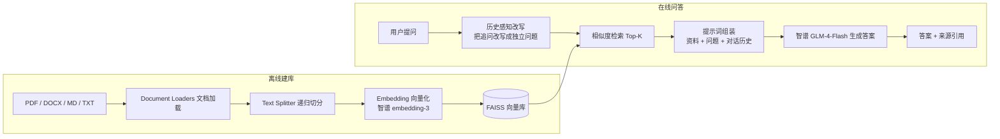

# 📚 智汇文档 · RAG 知识库问答助手

> 基于 **LangChain** 框架与**智谱 GLM 大模型**开发的智能应用：上传你的文档（PDF / Word / Markdown / TXT），即可进行基于文档内容的多轮智能问答，回答附带来源引用。

## 一、项目简介

大语言模型存在**知识过时**、**幻觉**、**不了解私有数据**三大问题。本项目基于 **RAG（Retrieval-Augmented Generation，检索增强生成）** 技术，把用户上传的文档切分、向量化后存入向量数据库；提问时先检索最相关的文档片段，再让大模型"看着资料回答"，从源头上缓解幻觉问题，使模型能够准确回答**私有领域知识**。

本项目是《智能应用开发》课程第七章配套大作业，实现了 RAG 的完整链路与工程化细节：

| 功能 | 说明 |
| --- | --- |
| 📄 多格式文档解析 | PDF（pypdf）、Word docx、Markdown、TXT，支持 GBK/UTF-8 编码回退 |
| ✂️ 语义文本切分 | `RecursiveCharacterTextSplitter` 按 段落→句子 层级递归切分，保留语义完整性 |
| 🔍 向量检索 | 智谱 `embedding-3` 向量化 + **FAISS** 本地向量库（持久化），Top-K 相似度检索 |
| 💬 多轮对话记忆 | 历史感知改写（追问"它是什么"也能正确检索）+ 会话级 Memory |
| 📎 答案来源引用 | 每个答案自动标注命中的文档与片段，可溯源 |
| 🖥️ 双端使用 | Gradio Web 界面 + 命令行 CLI，一套核心两种体验 |

## 二、系统架构



RAG 标准两阶段流程：

- **离线阶段（建库）**：文档加载 → 文本切分 → 向量化 → 存入向量数据库
- **在线阶段（问答）**：问题改写 → 向量检索 → 片段注入提示词 → 大模型生成答案

## 三、技术栈

| 组件 | 选型 | 说明 |
| --- | --- | --- |
| 应用框架 | LangChain ≥ 0.3 | Model I/O / Retrieval / Chains / Memory 全模块 |
| 大语言模型 | 智谱 GLM-4-Flash | 免费，OpenAI 兼容协议接入（`langchain-openai`） |
| 向量模型 | 智谱 embedding-3 | 中文语义向量化 |
| 向量数据库 | FAISS (faiss-cpu) | 本地运行、索引持久化、毫秒级检索 |
| Web 界面 | Gradio | 上传文档、对话、来源展示 |
| 运行环境 | Python ≥ 3.10 | Windows / macOS / Linux 通用 |

## 四、快速开始

### 1. 获取 API Key

1. 访问 [智谱 AI 开放平台](https://open.bigmodel.cn) 注册账号；
2. 进入控制台 → 「API Keys」→ 新建并复制；
3. GLM-4-Flash 模型**免费**调用，无需充值。

### 2. 安装与配置

```bash
# 克隆仓库
git clone https://github.com/Uryka-Lamy/rag-doc-assistant.git
cd rag-doc-assistant

# 安装依赖
pip install -r requirements.txt

# 配置密钥：复制 .env.example 为 .env，填入你的 ZHIPU_API_KEY
cp .env.example .env
```

`.env` 内容：

```ini
ZHIPU_API_KEY=你的APIKey
LLM_MODEL=glm-4-flash
EMBEDDING_MODEL=embedding-3
```

### 3. 启动 Web 界面

```bash
python app.py
```

浏览器自动打开 `http://127.0.0.1:7860`：

1. 点击 **「🧪 加载示例」** 体验内置示例文档（本课程大纲），或上传自己的文档后点击 **「⬆️ 上传建库」**；
2. 在右侧对话框提问，例如：*这门课的考核方式是什么？*
3. 支持多轮追问：*期末大作业具体要求是什么？* → *它需要提交哪些材料？*

### 4. 命令行使用

```bash
python cli.py                            # 自动用示例文档建库并进入问答
python cli.py --ingest 手册.pdf 笔记.md   # 用指定文档建库后问答
```

## 五、项目结构

```
rag-doc-assistant/
├── app.py                  # Gradio Web 界面入口
├── cli.py                  # 命令行入口
├── rag/                    # 核心包
│   ├── config.py           # 配置管理（.env 读取与校验）
│   ├── loader.py           # 文档加载（PDF/DOCX/MD/TXT）
│   ├── vectorstore.py      # 文本切分、FAISS 向量库构建/加载/清空
│   └── chain.py            # RAG 链：检索、提示词、记忆、生成
├── docs/sample/            # 内置示例文档
├── uploads/                # 用户上传文档（运行时生成）
├── vectorstore/            # FAISS 索引（运行时生成，不入库）
├── requirements.txt
└── .env.example            # 环境变量模板
```

## 六、核心原理讲解

### 1. 为什么要"先检索后生成"？

直接问大模型"本课程的考核方式"，模型无从得知课程文档内容，只能幻觉作答。RAG 把"开放域生成"变成"有资料支撑的封闭域生成"：

```
检索片段 + 用户问题 ──> 提示词 ──> LLM ──> 有据可依的答案
```

### 2. 历史感知检索（History-Aware Retriever）

多轮对话中用户常出现指代性追问（"它的满分是多少？"）。本项目先用 LLM 将"追问 + 聊天历史"改写成独立完整的问题（"这门课期末大作业的满分是多少？"）再去检索，解决了 RAG 在多轮场景下的检索漂移问题。

### 3. 会话记忆

通过 LangChain 的 `RunnableWithMessageHistory` 按 `session_id` 维护每轮对话的 `ChatMessageHistory`，链自动携带历史上下文，实现多轮连贯对话。

### 4. 抑制幻觉的提示词设计

系统提示词中强制要求：仅依据提供的资料回答、资料不足时明说、答案末尾标注来源文件，最大程度约束模型不编造。

## 七、效果演示

| 对话示例 | 截图 |
| --- | --- |
| 基于示例文档提问"这门课的考核方式是什么？"，助手准确答出 30% / 20% / 50% 并标注来源 | （运行后可自行截图替换） |

## 八、常见问题

<details>
<summary>报错"未配置 ZHIPU_API_KEY"？</summary>

未创建 `.env` 或 Key 未填写。复制 `.env.example` 为 `.env` 并填入有效 Key。
</details>

<details>
<summary>embedding 接口报错？</summary>

检查 `.env` 中 `EMBEDDING_MODEL=embedding-3` 是否被修改，并确认 Key 有效。
</details>

<details>
<summary>FAISS 安装失败？</summary>

Windows/macOS 直接 `pip install faiss-cpu` 即可；Linux 若失败可先 `pip install swig`。
</details>

## 九、课程与作者信息

- 课程：《智能应用开发》（第七章 大作业）
- 作者：徐仕杰（软件2405 · 20246028）
- 技术要点覆盖：LangChain 框架、在线大模型 API、RAG 检索增强、向量数据库、会话记忆、Gradio 应用开发
